# 🛠️ 개발 워크스테이션 구축 (Codyssey 입학연수)

> 저장소: https://github.com/sangukjeon/workstation

## 1. 프로젝트 개요

터미널(리눅스 CLI), Docker, Git/GitHub를 직접 세팅하여 **누가 실행해도 같은 결과가 나오는 개발 환경**을 구성하는 미션입니다.

- 터미널로 작업 디렉토리를 만들고 파일/권한을 다룹니다.
- Docker를 설치·점검하고 컨테이너를 실행·관리합니다.
- NGINX 베이스 이미지로 **커스텀 웹 서버 이미지**를 만들고 포트 매핑으로 접속합니다.
- 바인드 마운트로 "변경 즉시 반영", Docker 볼륨으로 "데이터 영속성"을 검증합니다.
- Git 설정 후 VSCode에서 GitHub와 연동하여 저장소에 업로드합니다.

모든 실행 로그는 실제 터미널 출력이며, 원본은 [`logs/`](logs/) 폴더에 있습니다.

## 2. 실행 환경

| 항목 | 내용 |
|---|---|
| Host OS | Windows + WSL2 |
| Linux | Ubuntu 26.04.1 LTS |
| Kernel | `6.18.54.1-microsoft-standard-WSL2` |
| Shell | bash |
| Terminal | Windows Terminal / VSCode 통합 터미널 (WSL: Ubuntu) |
| Docker | Docker version 29.9.2, build a82e528 (WSL Ubuntu에 Docker Engine 직접 설치) |
| Git | (터미널에서 `git --version` 실행 후 이 칸에 입력) |
| Editor | VSCode + WSL 확장 |

> **Docker 설치 방식 선택 이유**: WSL에서는 Docker Desktop이 권장되지만(설치 스크립트도 안내함), 미션의 "CLI 기반 수행" 요구에 맞춰 WSL Ubuntu 안에 Docker Engine을 공식 설치 스크립트(`get.docker.com`)로 직접 설치했습니다.

## 3. 저장소 구조

```text
workstation/
├── README.md            # 기술 문서 (본 문서)
├── app/
│   ├── Dockerfile       # 커스텀 웹 서버 이미지
│   └── site/index.html  # 정적 웹 페이지
├── docs/images/         # 스크린샷 증거
├── logs/                # 터미널/Docker 실행 원본 로그
└── practice/            # 터미널·권한 실습 디렉토리
```

## 4. 수행 체크리스트

- [x] 터미널 기본 조작 (pwd, ls -la, cd, mkdir, touch, cat, cp, mv, rm)
- [x] 권한 변경 실습 (파일 1개, 디렉토리 1개)
- [x] Docker 설치 및 점검 (`docker --version`, `docker info`)
- [x] hello-world 실행
- [x] ubuntu 컨테이너 진입 + attach/exec 차이 관찰
- [x] Docker 운영 명령 (images, ps, logs, stats)
- [x] Dockerfile 기반 커스텀 이미지 빌드/실행
- [x] 포트 매핑 접속 (8080, 8081 2회)
- [x] 바인드 마운트 변경 반영
- [x] Docker 볼륨 영속성
- [x] Git 설정 + VSCode GitHub 연동
- [x] 트러블슈팅 5건 기록

---

## 5. 수행 로그

### 5-1. 터미널 기본 조작

```text
$ pwd
/home/sanguk/codyssey/workstation

$ ls -la
total 52
drwxr-xr-x 7 sanguk sanguk  4096 Nov  4 02:34 .
drwxr-xr-x 3 sanguk sanguk  4096 Nov  4 00:47 ..
drwxr-xr-x 7 sanguk sanguk  4096 Nov  4 02:13 .git
drwxr-xr-x 3 sanguk sanguk  4096 Nov  4 01:59 app
drwxr-xr-x 3 sanguk sanguk  4096 Nov  4 01:14 docs
-rw-r--r-- 1 sanguk sanguk 23866 Nov  4 00:49 get-docker.sh
drwxr-xr-x 2 sanguk sanguk  4096 Nov  4 02:34 logs
drwx------ 2 sanguk sanguk  4096 Nov  4 01:53 perm_dir
-rwxr-xr-x 1 sanguk sanguk     0 Nov  4 01:53 perm_file.txt

$ mkdir -p practice/sub

$ cd practice

$ pwd
/home/sanguk/codyssey/workstation/practice

$ touch empty.txt

$ echo 'hello codyssey' > note.txt

$ cat note.txt
hello codyssey

$ cp note.txt note_copy.txt

$ mv note_copy.txt renamed.txt

$ mv renamed.txt sub/

$ ls -la sub
total 12
drwxr-xr-x 2 sanguk sanguk 4096 Nov  4 02:34 .
drwxr-xr-x 3 sanguk sanguk 4096 Nov  4 02:34 ..
-rw-r--r-- 1 sanguk sanguk   15 Nov  4 02:34 renamed.txt

$ rm sub/renamed.txt

$ rm -r sub

$ ls -la
total 12
drwxr-xr-x 2 sanguk sanguk 4096 Nov  4 02:34 .
drwxr-xr-x 8 sanguk sanguk 4096 Nov  4 02:34 ..
-rw-r--r-- 1 sanguk sanguk    0 Nov  4 02:34 empty.txt
-rw-r--r-- 1 sanguk sanguk   15 Nov  4 02:34 note.txt
```

**절대 경로 vs 상대 경로**

| 구분 | 예시 | 설명 |
|---|---|---|
| 절대 경로 | `cd /home/sanguk/codyssey/workstation` | 루트(`/`)부터 시작하는 전체 경로. 현재 위치와 상관없이 항상 같은 곳을 가리킴 |
| 상대 경로 | `cd practice`, `cd ../app` | 현재 위치를 기준으로 한 경로. `.`은 현재, `..`은 상위 디렉토리 |

### 5-2. 권한 실습

```text
$ touch perm_file.txt

$ mkdir perm_dir

$ ls -l perm_file.txt
-rw-r--r-- 1 sanguk sanguk 0 Nov  4 02:34 perm_file.txt

$ ls -ld perm_dir
drwxr-xr-x 2 sanguk sanguk 4096 Nov  4 02:34 perm_dir

$ chmod 755 perm_file.txt

$ chmod 700 perm_dir

$ ls -l perm_file.txt
-rwxr-xr-x 1 sanguk sanguk 0 Nov  4 02:34 perm_file.txt

$ ls -ld perm_dir
drwx------ 2 sanguk sanguk 4096 Nov  4 02:34 perm_dir

$ cd /home/sanguk/codyssey/workstation
```

**결과 비교**

| 대상 | 변경 전 | 변경 후 |
|---|---|---|
| `perm_file.txt` (파일) | `-rw-r--r--` (644) | `-rwxr-xr-x` (755) |
| `perm_dir` (디렉토리) | `drwxr-xr-x` (755) | `drwx------` (700) |

**권한 표기 해석 규칙**

- `r`(읽기)=4, `w`(쓰기)=2, `x`(실행)=1 을 더한 값
- 세 자리 숫자는 순서대로 **소유자 / 그룹 / 기타 사용자**
  - `755` = 소유자 rwx(7), 그룹 r-x(5), 기타 r-x(5)
  - `644` = 소유자 rw-(6), 그룹 r--(4), 기타 r--(4)
- 디렉토리의 `x`는 "디렉토리 안으로 들어갈 수 있는 권한". `700`이면 소유자만 진입 가능

### 5-3. Docker 설치 및 점검

```bash
curl -fsSL https://get.docker.com -o get-docker.sh
sudo sh get-docker.sh
sudo usermod -aG docker $USER   # sudo 없이 docker 사용 (재접속 필요)
```

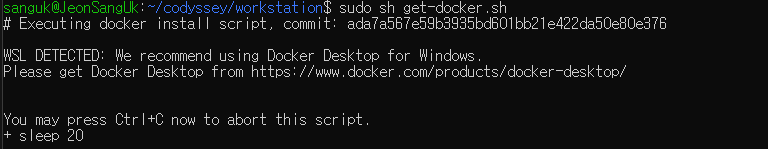

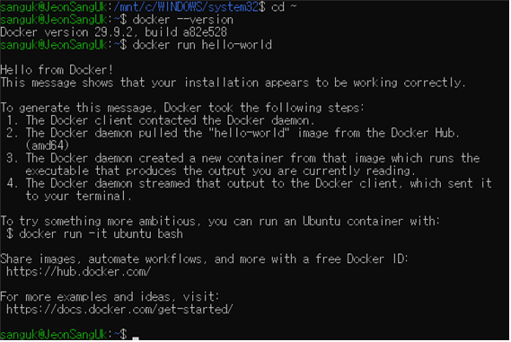

`docker --version`, `docker info`(데몬 동작 확인) 전체 출력은 5-6 로그에 포함되어 있습니다.

### 5-4. 컨테이너 실행 실습 (ubuntu, attach / exec)

```bash
docker run -it --name my-ubuntu ubuntu bash   # 컨테이너 진입 후 ls, echo 실행 → exit
docker ps -a                                   # Exited 확인
docker start my-ubuntu
docker exec -it my-ubuntu bash                 # 진입 → exit
docker ps                                      # 여전히 Up
docker attach my-ubuntu                        # 진입 → exit
docker ps -a                                   # Exited
```

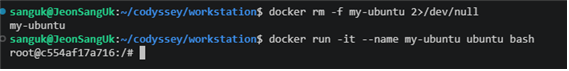

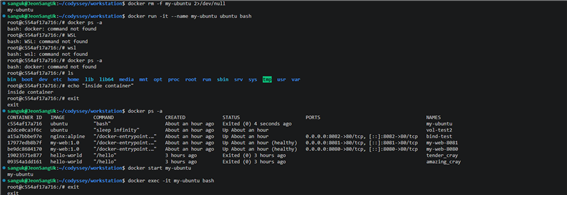

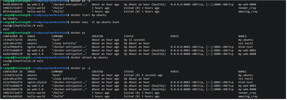

**관찰 결과**

| 방식 | 동작 | exit 후 컨테이너 상태 |
|---|---|---|
| `docker exec -it` | 컨테이너 안에 **새 프로세스(bash)** 를 추가로 띄움 | **Up** (유지) |
| `docker attach` | 컨테이너의 **메인 프로세스(PID 1)** 에 직접 연결 | **Exited** (종료) |

→ 메인 프로세스가 끝나면 컨테이너도 끝난다. 운영 중인 컨테이너에 들어갈 때는 `exec`을 쓰는 것이 안전하다.

### 5-5. Dockerfile 기반 커스텀 이미지

**선택한 방식**: (A) 웹 서버 베이스 이미지 활용 — 공식 `nginx:alpine` 이미지 + 정적 콘텐츠/메타데이터/헬스체크 추가

`app/Dockerfile`
```dockerfile
FROM nginx:alpine
LABEL org.opencontainers.image.title="my-workstation-web"
ENV APP_ENV=dev
COPY site/ /usr/share/nginx/html/
EXPOSE 80
HEALTHCHECK CMD wget -qO- http://localhost/ || exit 1
```

`app/site/index.html` (현재 내용)
```html
<h1>SangUk Workstation - v2 (bind mount)</h1>
```

**커스텀 포인트와 목적**

| 항목 | 목적 |
|---|---|
| `FROM nginx:alpine` | 가볍고 검증된 공식 웹 서버 이미지를 베이스로 사용 |
| `LABEL` | 이미지 이름 등 메타데이터 기록 (식별/관리용) |
| `ENV APP_ENV=dev` | 실행 모드를 환경 변수로 분리 (설정과 코드 분리) |
| `COPY site/ ...` | NGINX 기본 페이지를 내 정적 콘텐츠로 교체 |
| `EXPOSE 80` | 컨테이너가 사용하는 포트를 문서화 |
| `HEALTHCHECK` | 웹 서버가 응답하는지 주기적으로 점검 (`docker ps`에 healthy 표시) |

### 5-6. 빌드 · 포트 매핑 · 운영 명령 로그

```text
$ docker --version
Docker version 29.9.2, build a82e528

$ docker info
Client: Docker Engine - Community
 Version:    29.9.2
 Context:    default
 Debug Mode: false
 Plugins:
  buildx: Docker Buildx (Docker Inc.)
    Version:  v0.38.1
    Path:     /usr/libexec/docker/cli-plugins/docker-buildx
  compose: Docker Compose (Docker Inc.)
    Version:  v5.7.0
    Path:     /usr/libexec/docker/cli-plugins/docker-compose
  model: Docker Model Runner (Docker Inc.)
    Version:  v1.2.9
    Path:     /usr/libexec/docker/cli-plugins/docker-model

Server:
 Containers: 3
  Running: 0
  Paused: 0
  Stopped: 3
 Images: 4
 Server Version: 29.9.2
 Storage Driver: overlayfs
  driver-type: io.containerd.snapshotter.v1
 Logging Driver: json-file
 Cgroup Driver: systemd
 Cgroup Version: 2
 Plugins:
  Volume: local
  Network: bridge host ipvlan macvlan null overlay
  Log: awslogs fluentd gcplogs gelf journald json-file local splunk syslog
 CDI spec directories:
  /etc/cdi
  /var/run/cdi
 Swarm: inactive
 Runtimes: io.containerd.runc.v2 runc
 Default Runtime: runc
 Init Binary: docker-init
 containerd version: b7a25261e029d68978bbf290df0a62fc819b3c51
 runc version: v1.5.2-0-g29dd3dc2
 init version: de40ad0
 Security Options:
  seccomp
   Profile: builtin
  cgroupns
 Kernel Version: 6.18.54.1-microsoft-standard-WSL2
 Operating System: Ubuntu 26.04.1 LTS
 OSType: linux
 Architecture: x86_64
 CPUs: 16
 Total Memory: 15.45GiB
 Name: JeonSangUk
 ID: 9003a459-a3b9-47c0-a724-b45e205a95e2
 Docker Root Dir: /var/lib/docker
 Debug Mode: false
 Experimental: false
 Insecure Registries:
  127.0.0.0/8
  ::1/128
 Live Restore Enabled: false
 Firewall Backend: iptables
  EnableUserlandProxy: true
  UserlandProxyPath: /usr/bin/docker-proxy


$ docker images
IMAGE                ID             DISK USAGE   CONTENT SIZE   EXTRA
hello-world:latest   c567b231f656       25.9kB         9.49kB   U    
my-web:1.0           feaa23e6cb65       93.6MB         26.3MB        
nginx:alpine         785835ea65db       94.5MB         27.2MB        
ubuntu:latest        6a06111c3b0a        163MB         45.9MB   U    

$ docker build -t my-web:1.0 app
#0 building with "default" instance using docker driver

#1 [internal] load build definition from Dockerfile
#1 transferring dockerfile: 233B done
#1 DONE 0.0s

#2 [internal] load metadata for docker.io/library/nginx:alpine
#2 DONE 0.0s

#3 [internal] load .dockerignore
#3 transferring context: 2B done
#3 DONE 0.0s

#4 [internal] load build context
#4 transferring context: 144B done
#4 DONE 0.0s

#5 [1/2] FROM docker.io/library/nginx:alpine@sha256:785835ea65db4bba6f021acc0f3be91b0fef76a53fe41f8588c6698d2aed0606
#5 resolve docker.io/library/nginx:alpine@sha256:785835ea65db4bba6f021acc0f3be91b0fef76a53fe41f8588c6698d2aed0606 0.0s done
#5 CACHED

#6 [2/2] COPY site/ /usr/share/nginx/html/
#6 DONE 0.0s

#7 exporting to image
#7 exporting layers 0.0s done
#7 exporting manifest sha256:025aeae0a4a9bb041179bd388d0cc470a9124df27014a5019fdecf4d32281b94 done
#7 exporting config sha256:a5b5a0cb5713428c868262b2e03485b42b7815240e2ddedf1751fec4237a84e2 done
#7 exporting attestation manifest sha256:00a1ddf86a2f003597f11e57bb684389c25e360fa1b98521a9f3e80037ea012d done
#7 exporting manifest list sha256:8d909feedf10aefab881d2eea8dd60d579e4ebce0b2b30380bf74d8b02e9a5e3 done
#7 naming to docker.io/library/my-web:1.0 done
#7 unpacking to docker.io/library/my-web:1.0 0.0s done
#7 DONE 0.1s

$ docker run -d -p 8080:80 --name my-web-8080 my-web:1.0
be9dc8684170a3d22686ee37a61051038675268a760ff70605c1c3c9529447b4

$ docker run -d -p 8081:80 --name my-web-8081 my-web:1.0
17977edb8b7fbd8d18d765a4f142b006b78ce192eb77e19717a508e8526104b0

$ sleep 2

$ curl -s http://localhost:8080
<!DOCTYPE html><html><body><h1>SangUk Workstation - v1</h1></body></html>

$ curl -s http://localhost:8081
<!DOCTYPE html><html><body><h1>SangUk Workstation - v1</h1></body></html>

$ docker ps
CONTAINER ID   IMAGE        COMMAND                  CREATED         STATUS                            PORTS                                     NAMES
17977edb8b7f   my-web:1.0   "/docker-entrypoint.…"   3 seconds ago   Up 2 seconds (health: starting)   0.0.0.0:8081->80/tcp, [::]:8081->80/tcp   my-web-8081
be9dc8684170   my-web:1.0   "/docker-entrypoint.…"   3 seconds ago   Up 2 seconds (health: starting)   0.0.0.0:8080->80/tcp, [::]:8080->80/tcp   my-web-8080

$ docker logs my-web-8080
/docker-entrypoint.sh: /docker-entrypoint.d/ is not empty, will attempt to perform configuration
/docker-entrypoint.sh: Looking for shell scripts in /docker-entrypoint.d/
/docker-entrypoint.sh: Launching /docker-entrypoint.d/10-listen-on-ipv6-by-default.sh
10-listen-on-ipv6-by-default.sh: info: Getting the checksum of /etc/nginx/conf.d/default.conf
10-listen-on-ipv6-by-default.sh: info: Enabled listen on IPv6 in /etc/nginx/conf.d/default.conf
/docker-entrypoint.sh: Sourcing /docker-entrypoint.d/15-local-resolvers.envsh
/docker-entrypoint.sh: Launching /docker-entrypoint.d/20-envsubst-on-templates.sh
/docker-entrypoint.sh: Launching /docker-entrypoint.d/30-tune-worker-processes.sh
/docker-entrypoint.sh: Configuration complete; ready for start up
2026/11/03 17:33:27 [notice] 1#1: using the "epoll" event method
2026/11/03 17:33:27 [notice] 1#1: nginx/1.31.8
2026/11/03 17:33:27 [notice] 1#1: built by gcc 15.2.0 (Alpine 15.2.0) 
2026/11/03 17:33:27 [notice] 1#1: OS: Linux 6.18.54.1-microsoft-standard-WSL2
2026/11/03 17:33:27 [notice] 1#1: getrlimit(RLIMIT_NOFILE): 1024:1048576
2026/11/03 17:33:27 [notice] 1#1: start worker processes
2026/11/03 17:33:27 [notice] 1#1: start worker process 30
2026/11/03 17:33:27 [notice] 1#1: start worker process 31
2026/11/03 17:33:27 [notice] 1#1: start worker process 32
2026/11/03 17:33:27 [notice] 1#1: start worker process 33
2026/11/03 17:33:27 [notice] 1#1: start worker process 34
2026/11/03 17:33:27 [notice] 1#1: start worker process 35
2026/11/03 17:33:27 [notice] 1#1: start worker process 36
2026/11/03 17:33:27 [notice] 1#1: start worker process 37
2026/11/03 17:33:27 [notice] 1#1: start worker process 38
2026/11/03 17:33:27 [notice] 1#1: start worker process 39
2026/11/03 17:33:27 [notice] 1#1: start worker process 40
2026/11/03 17:33:27 [notice] 1#1: start worker process 41
2026/11/03 17:33:27 [notice] 1#1: start worker process 42
2026/11/03 17:33:27 [notice] 1#1: start worker process 43
2026/11/03 17:33:27 [notice] 1#1: start worker process 44
2026/11/03 17:33:27 [notice] 1#1: start worker process 45
172.17.0.1 - - [03/Nov/2026:17:33:30 +0000] "GET / HTTP/1.1" 200 74 "-" "curl/8.18.0" "-"

$ docker stats --no-stream
CONTAINER ID   NAME          CPU %     MEM USAGE / LIMIT     MEM %     NET I/O         BLOCK I/O         PIDS
17977edb8b7f   my-web-8081   0.00%     14.89MiB / 15.45GiB   0.09%     1.34kB / 816B   0B / 8.19kB       17
be9dc8684170   my-web-8080   0.00%     14.74MiB / 15.45GiB   0.09%     1.49kB / 816B   4.49MB / 12.3kB   17
```

**브라우저 접속 증거**

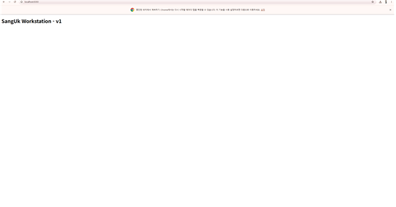

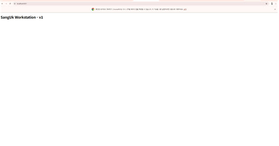

**포트 매핑이 필요한 이유**: 컨테이너는 호스트와 격리된 자체 네트워크를 가지므로, 컨테이너 안 NGINX가 80번 포트로 떠 있어도 호스트에서는 바로 접근할 수 없다. `-p 8080:80`은 "호스트의 8080번으로 들어온 요청을 컨테이너의 80번으로 전달"하라는 설정이다. 같은 이미지라도 호스트 포트만 다르게 주면(8080, 8081) 여러 개를 동시에 띄울 수 있다.

### 5-7. 바인드 마운트 (변경 즉시 반영)

```text
$ docker run -d -p 8082:80 --name bind-test -v "$(pwd)/app/site:/usr/share/nginx/html" nginx:alpine
a15a7bbbe97e1a06a82d541137e546db501df3b2f4d66027ee98e2a764d10f72

$ sleep 2

$ curl -s http://localhost:8082
<!DOCTYPE html><html><body><h1>SangUk Workstation - v1</h1></body></html>

$ echo '<h1>SangUk Workstation - v2 (bind mount)</h1>' > app/site/index.html

$ curl -s http://localhost:8082
<h1>SangUk Workstation - v2 (bind mount)</h1>
```

호스트의 `app/site` 폴더를 컨테이너의 NGINX 웹 루트에 직접 연결했기 때문에, **이미지를 다시 빌드하지 않아도** 호스트에서 파일을 수정하자마자 응답이 v1 → v2로 바뀌었다. (`COPY`로 이미지에 넣은 8080/8081 컨테이너는 v1 그대로 유지)

### 5-8. Docker 볼륨 (데이터 영속성)

```text
$ docker volume create mydata
mydata

$ docker run -d --name vol-test -v mydata:/data ubuntu sleep infinity
032494ec0774add633a69528cb7b736785f37f3a03048dbbed7425824baa9706

$ docker exec vol-test sh -c 'echo persist-me > /data/hello.txt; cat /data/hello.txt'
persist-me

$ docker rm -f vol-test
vol-test

$ docker ps -a
CONTAINER ID   IMAGE          COMMAND                  CREATED             STATUS                            PORTS                                     NAMES
a15a7bbbe97e   nginx:alpine   "/docker-entrypoint.…"   3 seconds ago       Up 2 seconds                      0.0.0.0:8082->80/tcp, [::]:8082->80/tcp   bind-test
17977edb8b7f   my-web:1.0     "/docker-entrypoint.…"   7 seconds ago       Up 6 seconds (health: starting)   0.0.0.0:8081->80/tcp, [::]:8081->80/tcp   my-web-8081
be9dc8684170   my-web:1.0     "/docker-entrypoint.…"   7 seconds ago       Up 6 seconds (health: starting)   0.0.0.0:8080->80/tcp, [::]:8080->80/tcp   my-web-8080
d9c7e74370c1   ubuntu         "bash"                   39 minutes ago      Exited (0) 39 minutes ago                                                   my-ubuntu
19023571e877   hello-world    "/hello"                 About an hour ago   Exited (0) About an hour ago                                                tender_cray
09354a1dd161   hello-world    "/hello"                 2 hours ago         Exited (0) 2 hours ago                                                      amazing_cray

$ docker run -d --name vol-test2 -v mydata:/data ubuntu sleep infinity
a2dce0ca3f6c7d3450ed712cee29250f1954f8cfc3e1ee43ee98bb278b659175

$ docker exec vol-test2 cat /data/hello.txt
persist-me

$ docker volume inspect mydata
[
    {
        "CreatedAt": "2026-11-04T02:33:33+09:00",
        "Driver": "local",
        "Labels": null,
        "Mountpoint": "/var/lib/docker/volumes/mydata/_data",
        "Name": "mydata",
        "Options": null,
        "Scope": "local"
    }
]
```

`vol-test` 컨테이너를 삭제(`docker rm -f`)한 뒤, 같은 볼륨 `mydata`를 연결한 새 컨테이너 `vol-test2`에서 파일이 그대로 읽혔다. → **데이터는 컨테이너가 아니라 Docker가 관리하는 볼륨에 저장**되므로 컨테이너 수명과 무관하게 유지된다.

### 5-9. Git 설정 및 GitHub 연동

```bash
git config --global user.name "sangukjeon"
git config --global user.email "(마스킹)"
git config --global init.defaultBranch main
```

`git config --list` (이메일 마스킹)
```text
user.name=sangukjeon
user.email=j***@gmail.com
init.defaultbranch=main
```

커밋 이력 (VSCode Graph 기준)
```text
chore: update perm_file permission
init: workstation mission
```

`git remote -v`
```text
origin	https://github.com/sangukjeon/workstation.git (fetch)
origin	https://github.com/sangukjeon/workstation.git (push)
```

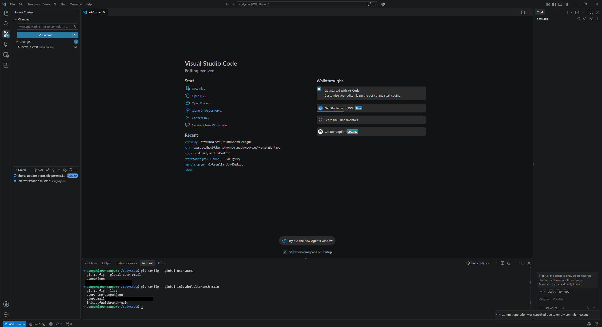

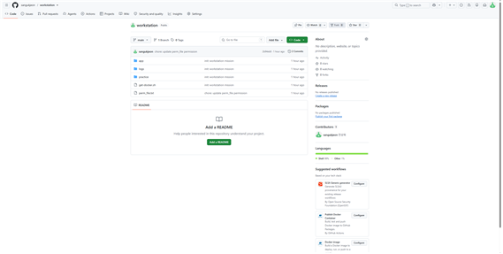

---

## 6. 검증 방법

| 항목 | 검증 명령 | 확인 내용 | 증거 위치 |
|---|---|---|---|
| 터미널 조작 | `pwd`, `ls -la` 등 | 생성·복사·이동·삭제 결과 | [5-1](#5-1-터미널-기본-조작), `logs/terminal-evidence.log` |
| 권한 | `ls -l`, `ls -ld` | 644→755, 755→700 변경 | [5-2](#5-2-권한-실습) |
| Docker 설치 | `docker --version`, `docker info` | 버전 출력, Server 섹션 존재 | [5-3](#5-3-docker-설치-및-점검), [5-6](#5-6-빌드--포트-매핑--운영-명령-로그) |
| hello-world | `docker run hello-world` | "Hello from Docker!" | [5-3](#5-3-docker-설치-및-점검) |
| attach/exec | `docker ps`, `docker ps -a` | exec 후 Up, attach 후 Exited | [5-4](#5-4-컨테이너-실행-실습-ubuntu-attach--exec) |
| 커스텀 이미지 | `docker build`, `docker images` | `my-web:1.0` 생성 | [5-5](#5-5-dockerfile-기반-커스텀-이미지), [5-6](#5-6-빌드--포트-매핑--운영-명령-로그) |
| 포트 매핑 | `curl localhost:8080/8081`, 브라우저 | 페이지 응답 | [5-6](#5-6-빌드--포트-매핑--운영-명령-로그) |
| 운영 명령 | `docker ps`, `logs`, `stats` | 상태·로그·리소스 출력 | [5-6](#5-6-빌드--포트-매핑--운영-명령-로그) |
| 바인드 마운트 | 파일 수정 전후 `curl localhost:8082` | v1 → v2 즉시 반영 | [5-7](#5-7-바인드-마운트-변경-즉시-반영) |
| 볼륨 | 컨테이너 삭제 후 `cat /data/hello.txt` | 데이터 유지 | [5-8](#5-8-docker-볼륨-데이터-영속성) |
| Git/GitHub | `git config --list`, `git log`, 저장소 페이지 | 설정 완료, push 완료 | [5-9](#5-9-git-설정-및-github-연동) |

## 7. 트러블슈팅

### ① WSL 실행 시 "설치된 배포가 없습니다"
- **문제**: PowerShell에서 `wsl` 실행 시 Linux 배포판이 없다는 메시지 출력
- **원인 가설**: WSL 기능만 활성화되어 있고 Ubuntu 같은 배포판이 설치되지 않음
- **확인**: `wsl -l -v` 결과 목록이 비어 있음
- **해결**: `wsl --install -d Ubuntu` 실행 → 재부팅 → 사용자 계정 생성 후 `wsl -l -v`로 VERSION 2 확인

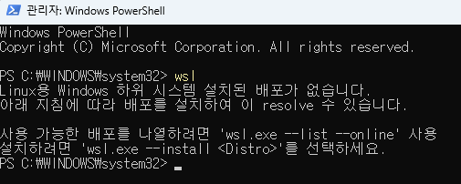

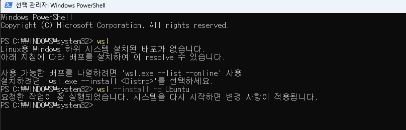

### ② PowerShell에서 `docker` 명령 인식 불가
- **문제**: VSCode 터미널에서 `docker build` 실행 시 "'docker' 용어가 cmdlet ... 으로 인식되지 않습니다"
- **원인 가설**: Docker는 WSL Ubuntu에만 설치했는데 Windows PowerShell에서 실행함
- **확인**: 프롬프트가 `PS C:\...`로 시작 (WSL이 아님)
- **해결**: VSCode에 WSL 확장 설치 → WSL 터미널에서 `code .` 실행 → 상태 표시줄 `WSL: Ubuntu` 확인. 작업 파일도 Windows 바탕화면에서 `~/codyssey/workstation`으로 이동 (`/mnt/c`는 chmod·바인드 마운트가 정상 동작하지 않거나 느림)

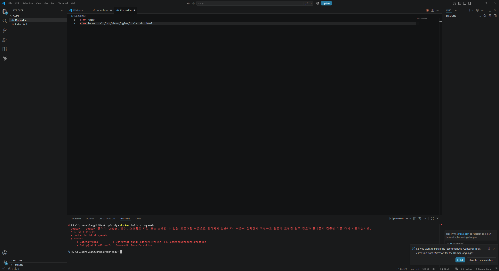

### ③ VSCode Commit 시 "configure user.name and user.email"
- **문제**: WSL 터미널에서는 커밋이 되는데 VSCode 소스 제어에서 Commit 시 사용자 정보 오류
- **원인 가설**: VSCode가 WSL이 아닌 Windows 쪽 Git을 사용 중이며, Windows Git에는 사용자 정보가 없음
- **확인**: VSCode 왼쪽 아래 상태 표시줄에 `WSL: Ubuntu` 표시 없음
- **해결**: `><` 아이콘 → Reopen Folder in WSL로 다시 열어 WSL Git(설정 완료 상태) 사용. 이후 `git config --list`로 설정 확인

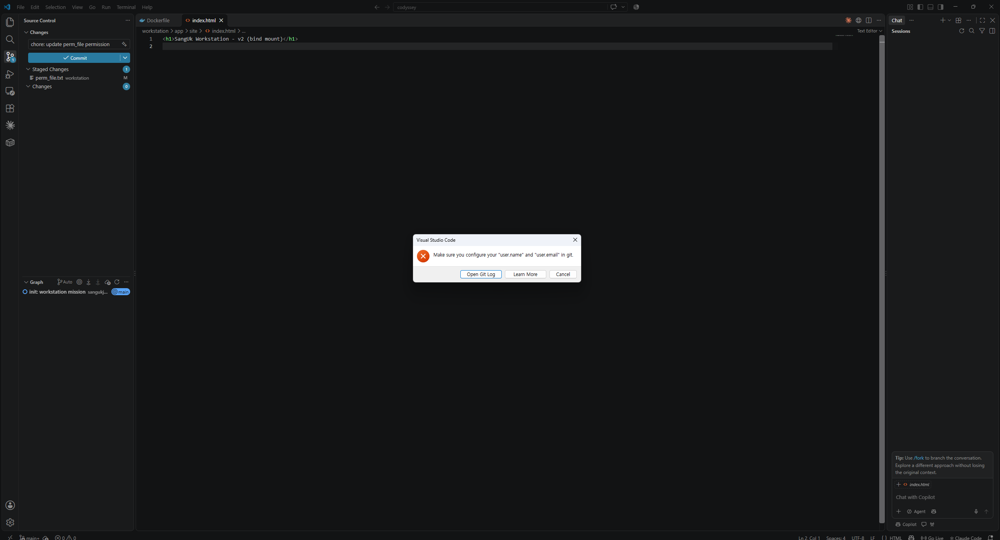

### ④ 포트 충돌: "port is already allocated"
- **문제**: `docker run -d -p 8080:80 nginx:alpine` 실행 시 컨테이너 시작 실패
- **원인 가설**: 이미 다른 컨테이너(`my-web-8080`)가 호스트 8080 포트를 사용 중
- **확인**: `docker ps`의 PORTS 열에서 `0.0.0.0:8080->80/tcp` 확인
- **해결**: 다른 호스트 포트 사용(`-p 8083:80`) 또는 기존 컨테이너 정리(`docker rm -f my-web-8080`)

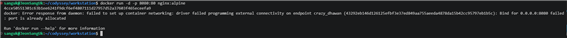

### ⑤ 컨테이너 안에서 `docker: command not found`
- **문제**: ubuntu 컨테이너 내부(`root@...:/#`)에서 `docker ps -a` 실행 시 명령을 찾을 수 없음
- **원인 가설**: 컨테이너는 호스트와 격리된 별도 파일시스템을 가지며, ubuntu 이미지에는 docker CLI가 없음
- **확인**: 프롬프트가 `root@<컨테이너ID>`로 바뀌어 있음 → 컨테이너 내부임
- **해결**: `exit`로 호스트(`sanguk@...`)로 나와서 실행. → "지금 어느 환경(호스트/컨테이너)에 있는지"를 프롬프트로 확인하는 습관이 중요

## 8. 개념 정리

| 개념 | 설명 |
|---|---|
| 이미지 vs 컨테이너 | 이미지는 실행 환경을 담은 **읽기 전용 설계도**, 컨테이너는 그 이미지로 띄운 **실행 중인 인스턴스**. 하나의 이미지로 여러 컨테이너(8080, 8081)를 만들 수 있다 |
| 포트 매핑 | 격리된 컨테이너 네트워크를 호스트 포트와 연결해 외부에서 접근 가능하게 함 |
| 바인드 마운트 | 호스트의 특정 폴더를 컨테이너에 그대로 연결. 개발 중 코드 변경을 즉시 반영할 때 유용 |
| 볼륨 | Docker가 관리하는 저장 공간. 컨테이너를 삭제해도 데이터가 유지됨 (DB 데이터 등) |
| Git vs GitHub | Git은 **내 PC에서 버전을 기록하는 도구**(로컬), GitHub는 Git 저장소를 **원격에 올려 공유·협업하는 플랫폼** |

## 9. 재현 방법 (평가자용)

```bash
git clone https://github.com/sangukjeon/workstation.git
cd workstation/app
docker build -t my-web:1.0 .
docker run -d -p 8080:80 --name my-web-8080 my-web:1.0
curl http://localhost:8080
```

**환경 의존 주의사항**
- Windows에서는 반드시 **WSL 터미널**에서 실행 (PowerShell에서는 docker 명령 불가 → 트러블슈팅 ②)
- 작업 폴더는 `/mnt/c/...`가 아닌 WSL 홈(`~`) 아래에 둘 것
- 8080 포트가 사용 중이면 `-p 8090:80`처럼 다른 포트로 변경
- `$(pwd)` 경로는 실행 위치에 따라 달라지므로 바인드 마운트 시 현재 위치 확인

## 10. 보안 및 개인정보

- `git config --list`의 이메일, 원격 URL의 인증 정보는 마스킹 처리
- 토큰·비밀번호·개인키는 저장소/로그/스크린샷에 포함하지 않음
- GitHub 인증은 VSCode 로그인(브라우저 OAuth)으로 처리하여 토큰을 직접 다루지 않음
